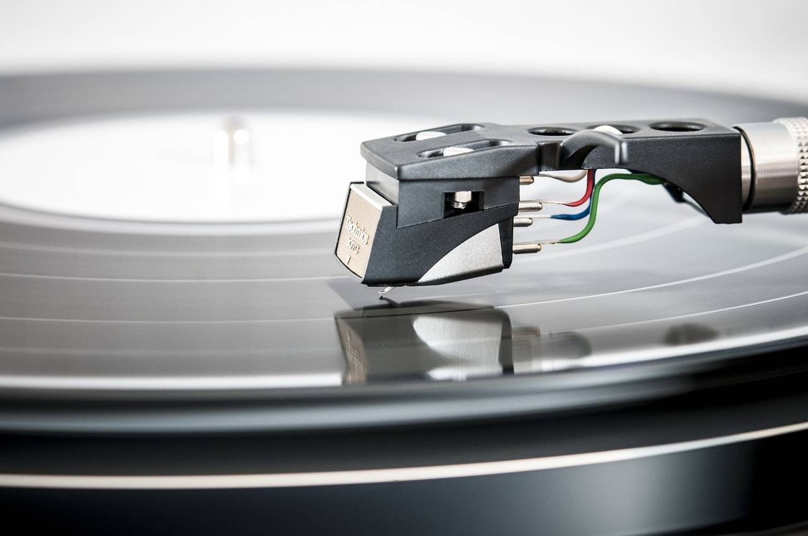

# Model Predictive Control (MPC) with Discrete, Continuous, Linear or Nonlinear Models

[Model Predictive Control MPC]Use discrete, continuous, linear or nonlinear models to model predictive control (Matlab code implementation)

## Images

<!-- PAYMENT_BLOCK -->

## Get this dataset

- Payment link (Stripe): [Buy now](https://buy.stripe.com/3cs8yP7sY87d0vu9AB)
- Payment QR code: 

<!-- /PAYMENT_BLOCK -->
